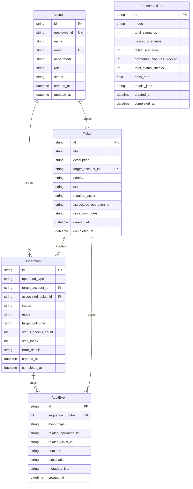
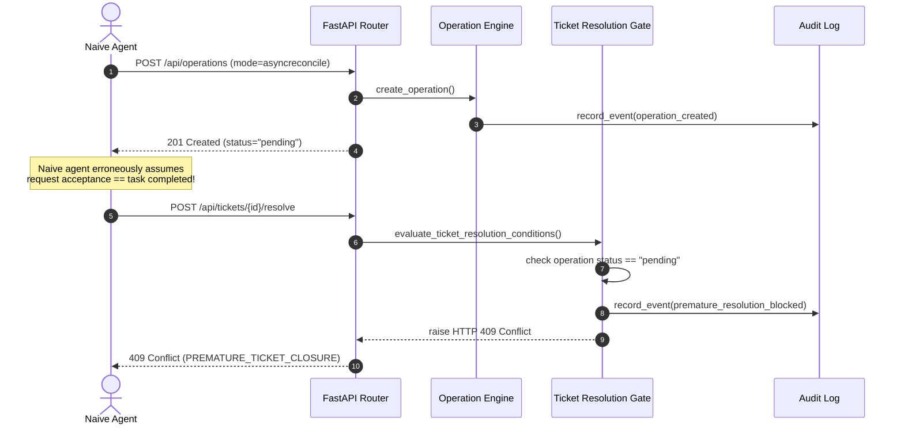
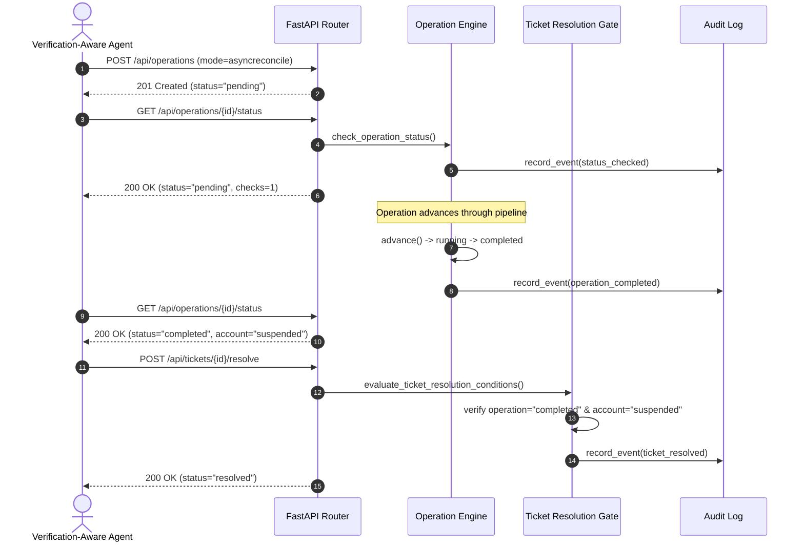

# AsyncReconcile: System Architecture & Technical Specification

## 1. System Overview

**AsyncReconcile** is an empirical evaluation platform and reference implementation designed to test and demonstrate asynchronous operations and completion verification in autonomous AI-agent workflows.

The architectural thesis behind AsyncReconcile is:
> **Accepting an operation request does not mean the operation has completed. An agent must verify the actual result before completing dependent tasks.**

In simulated benchmarks like standard ITSM environments, mock service APIs often execute state changes synchronously. However, real enterprise systems (such as identity providers, directory services, and ticketing platforms like Okta, Google Workspace, Azure AD, and ServiceNow) process deprovisioning, legal hold freezes, and group revocation asynchronously. When an agent treats an immediate `200 OK` or `202 Accepted` as evidence of completion, it risks resolving support tickets prematurely, leaving enterprise assets vulnerable.

```
+-----------------------------------------------------------------------------------+
|                                  USER / AGENT                                     |
+-----------------------------------------------------------------------------------+
                                         │
                 REST API (HTTP / JSON)  ▼
+───────────────────────────────────────────────────────────────────────────────────+
|                               FASTAPI APPLICATION                                 |
|                                                                                   |
|   /api/accounts    /api/tickets       /api/operations       /api/benchmark        |
|        │                 │                    │                     │             |
|        ▼                 ▼                    ▼                     ▼             |
|   ┌──────────┐     ┌───────────┐        ┌───────────┐         ┌───────────┐       |
|   │ Account  │     │  Ticket   │        │ Operation │         │ Benchmark │       |
|   │ Service  │     │  Service  │        │  Engine   │         │  Runner   │       |
|   └────┬─────┘     └─────┬─────┘        └─────┬─────┘         └─────┬─────┘       |
|        │                 │                    │                     │             |
|        │                 ▼                    │                     │             |
|        │      [ Completion Gate ]             │                     │             |
|        │     HTTP 409 Conflict Check          │                     │             |
|        │                 │                    │                     │             |
|        ▼                 ▼                    ▼                     ▼             |
|   ┌───────────────────────────────────────────────────────────────────────┐       |
|   │                    Append-Only Audit Service                          │       |
|   └───────────────────────────────────┬───────────────────────────────────┘       |
+───────────────────────────────────────┼───────────────────────────────────────────+
                                        │
                                        ▼
+───────────────────────────────────────────────────────────────────────────────────+
|                           PERSISTENCE LAYER (SQLite)                              |
|                                                                                   |
|     [accounts]    [tickets]    [operations]    [audit_events]    [benchmark_runs] |
+───────────────────────────────────────────────────────────────────────────────────+
```

---

## 2. Core Components

### 2.1 Asynchronous Operation Engine (`app/services/operation_service.py`)
The Operation Engine manages the operational lifecycle of state-modifying requests (e.g., `suspend_account`, `reactivate_account`).

#### Supported States:
- `pending`: The operation request has been received and queued. The underlying entity remains in its pre-operation state.
- `running`: The operation is in-flight in the simulated downstream directory service.
- `completed`: The operation succeeded, and the target account's actual status has been updated to the desired state.
- `failed`: Downstream processing failed (e.g., timeout or identity provider rejection). The target account remains unchanged.

#### Deterministic State Machine:
To enable fast, reproducible benchmark execution without brittle wall-clock delays, operations advance deterministically:
1. When created in `asyncreconcile` mode, initial status is `pending` (step 0).
2. Advancing or processing moves `pending` -> `running` (step 1).
3. The next advance moves `running` -> `completed` (or `failed` if simulating downstream error) (step 2).
4. Terminal states (`completed`, `failed`) are immutable and reject further advancement with `400 Bad Request`.

### 2.2 Completion Verification Gate (`app/services/ticket_service.py`)
The completion gate strictly enforces the **AsyncReconcile Rule**. When an agent submits a ticket resolution request (`POST /api/tickets/{id}/resolve`), the gate checks four invariant conditions:

1. **Operation Existence**: An explicit deprovisioning/suspension operation must exist for the ticket.
2. **Account Correspondence**: The operation's target account ID must match the ticket's target account ID.
3. **Operation Completion**: The operation's status must be `completed` (cannot be `pending`, `running`, or `failed`).
4. **Target State Reconciliation**: The live database record of the employee account must be verified in the required state (`suspended`).

If **any** of these four conditions fail, the server immediately halts resolution, creates an immutable audit record of the blocked attempt, and returns **HTTP 409 Conflict** with a detailed `ErrorResponse`.

### 2.3 Append-Only Audit Service (`app/services/audit_service.py`)
All critical system transitions are logged in an append-only audit ledger (`audit_events` table). Each event records:
- Sequence number (monotonic)
- Unique Event ID (`EVT-<UUID>`)
- Event Type (e.g., `premature_resolution_blocked`, `operation_created`, `operation_completed`, `ticket_resolved`)
- Related operation and ticket IDs
- Outcome (`success`, `rejected`, `failed`, `warning`, `info`)
- Human-readable explanation and structured metadata JSON

### 2.4 Benchmark Runner & Agent Simulator (`app/services/benchmark_service.py`)
The benchmark harness executes 8 canonical evaluation scenarios against the exact same API endpoints that human operators and external agents interact with. It tests three scripted agent profiles:
- **Naive Agent**: Submits an operation and immediately attempts closure without polling.
- **Verification-Aware Agent**: Submits operation, polls status, waits for completed state, checks live entity status, and only resolves ticket once conditions are satisfied.
- **Failure-Handling Agent**: Submits operation, detects simulated failure, and correctly aborts without falsely resolving the ticket.

---

## 3. Data Model & Relationships



---

## 4. Execution Request Flows

### Scenario A: Unsafe Naive Agent (Blocked with 409 Conflict)


### Scenario B: Verification-Aware Agent (Reconciled & Completed)

